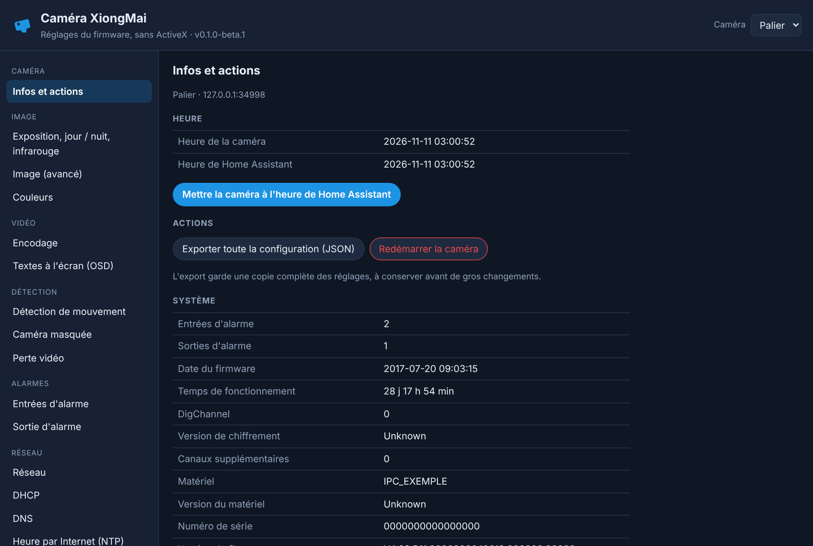
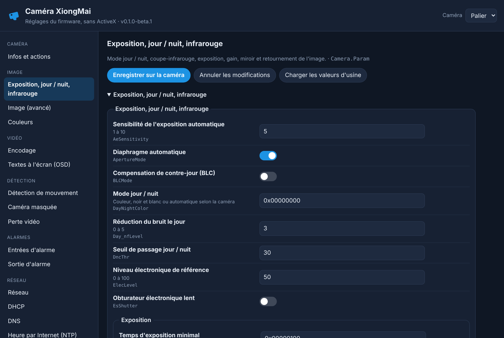
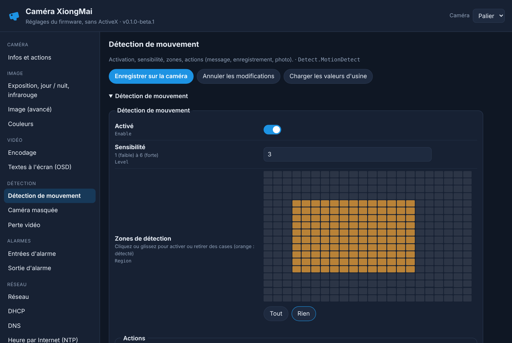

<p>
  ☕ <strong>Si cette application vous est utile, vous pouvez soutenir le projet :</strong>
</p>

<div style="white-space: nowrap; line-height: 0;">
  <a
    href="https://www.buymeacoffee.com/Marlboro62"
    target="_blank"
    rel="noopener noreferrer"
    style="display: inline-block; text-decoration: none; vertical-align: middle;"
  ></a>&nbsp;&nbsp;<a
    href="https://ko-fi.com/M4M2QL45X"
    target="_blank"
    rel="noopener noreferrer"
    style="display: inline-block; text-decoration: none; vertical-align: middle;"
  ></a>
</div>

# Caméra XiongMai pour Home Assistant

[](https://my.home-assistant.io/redirect/supervisor_add_addon_repository/?repository_url=https%3A%2F%2Fgithub.com%2FMarlboro62%2Fxiongmai-camera)

**Application Home Assistant pour régler les caméras IP XiongMai / XMEye / NetSurveillance**, directement depuis Home Assistant, **sans ActiveX ni Internet Explorer**.

Ces caméras se règlent d'habitude avec l'interface « NetSurveillance WEB », qui exige un ActiveX et Internet Explorer, de plus en plus difficile à installer sur les Windows récents, ou avec le logiciel CMS. Cette application parle directement à la caméra avec son propre protocole (DVRIP, port 34567) et affiche ses réglages en français.

| Infos et actions | Image | Zones de détection |
| --- | --- | --- |
|  |  |  |

*Captures réalisées avec la caméra simulée fournie dans le dépôt : valeurs fictives.*

## Ce qu'elle permet

- **Image** : mode jour / nuit, filtre infrarouge, exposition, gain, contre-jour, image miroir et retournée, couleurs (luminosité, contraste, saturation…).
- **Vidéo** : encodage des flux principal et secondaire (codec, résolution, images par seconde, débit), textes à l'écran (nom, heure).
- **Détection** : détection de mouvement avec **grille des zones** à dessiner, sensibilité et actions ; caméra masquée, perte vidéo.
- **Alarmes** : entrées et sortie d'alarme.
- **Réseau** : adresse IP (affichée en clair, pas en hexadécimal), DNS, DHCP, NTP, RTSP, **cloud XMEye** (à couper si la caméra n'a pas Internet).
- **Système** : nom, langue, format de date, heure d'été ; **mise à l'heure** sur celle de Home Assistant ; **redémarrage** (confirmé par un second clic).
- **Éditeur JSON** pour tous les autres réglages du firmware.
- **Sauvegarde automatique** de chaque section avant de l'écrire (les 30 dernières), et retour à une sauvegarde en deux clics ; **export** de toute la configuration en un fichier.
- **Plusieurs caméras**, choisies en haut de la page.

La page est accessible seulement depuis Home Assistant (barre latérale), par un utilisateur connecté. L'application ne parle qu'aux caméras de votre réseau local : la caméra peut rester **sans accès à Internet**.

## Installation

1. Ajoutez ce dépôt : bouton ci-dessus, ou **Paramètres › Applications › Boutique › ⋮ › Dépôts** puis `https://github.com/Marlboro62/xiongmai-camera`.
2. Installez **Caméra XiongMai** (Home Assistant construit l'image : une ou deux minutes).
3. Onglet **Configuration** : ajoutez votre caméra.
   ```yaml
   cameras:
     - name: Palier
       host: 192.168.1.50
       port: 34567
       username: admin
       password: ""
   ```
4. Démarrez l'application, puis ouvrez **Caméra XiongMai** dans la barre latérale.

Détails : [documentation](xiongmai_camera/DOCS.md).

## Prudence

- Commencez par **Infos et actions › Exporter toute la configuration** pour garder une copie de vos réglages.
- Les réglages **Réseau** (adresse, ports, DHCP) peuvent rendre la caméra injoignable s'ils sont faux : la page demande une confirmation.
- La **mise à jour du firmware** n'est volontairement pas proposée : c'est la seule opération qui peut rendre une caméra inutilisable.
- Les firmwares XiongMai diffèrent d'un modèle à l'autre : un réglage absent de votre caméra affiche « Lecture impossible ». Testé avec un firmware V4.02 (NetSurveillance WEB) ; vos retours sur d'autres modèles sont les bienvenus.

## Signaler un problème

Ouvrez une [issue GitHub](https://github.com/Marlboro62/xiongmai-camera/issues), avec le modèle de la caméra, la version du firmware (page **Infos et actions**) et le journal de l'application. **Masquez le numéro de série et vos adresses.**

## Licence

MIT. Projet indépendant, sans lien avec Hangzhou Xiongmai Technology. XiongMai, XMEye et NetSurveillance sont des marques de leurs propriétaires.
